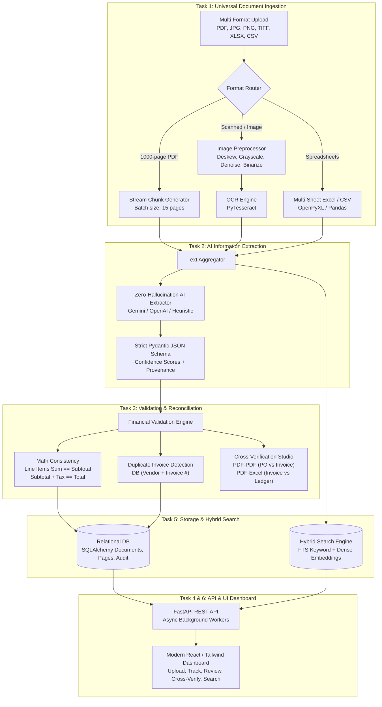
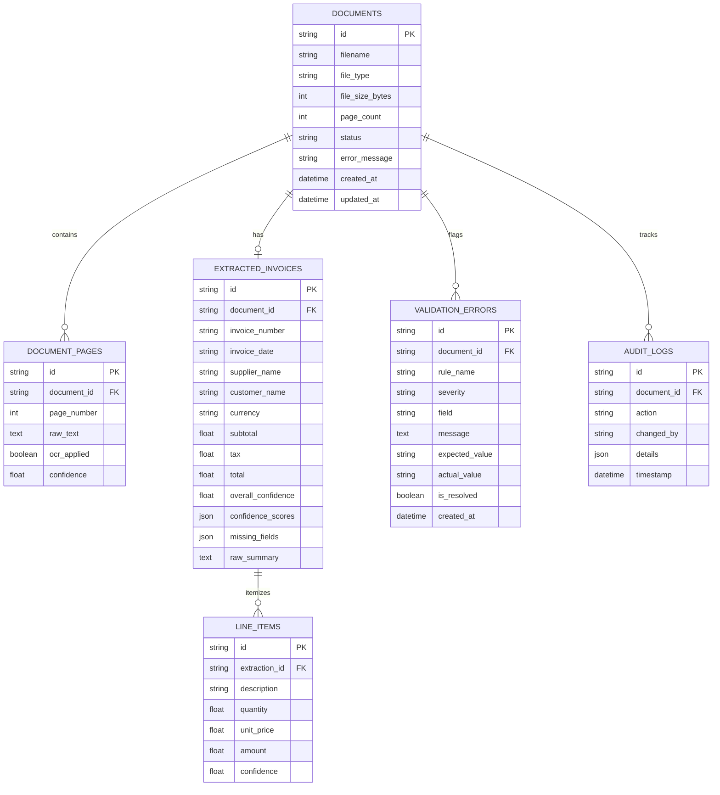

# AI-Powered Document Intelligence & Reconciliation System

An enterprise-grade document intelligence platform designed to process thousands of multi-format business documents daily (PDFs up to 1000 pages, scanned images, Excel workbooks, and CSV files), extract structured financial invoice details, execute automated mathematical validation, and perform cross-document reconciliation (PDF-to-PDF & PDF-to-Excel).

---

## 1. System Architecture



---

## 2. Database Schema (ER Diagram)



---

## 3. Benchmark Evaluation Results

Evaluated against the labeled financial test dataset in `evaluation/benchmark_dataset.json`:

| Metric | Result | Target Standard |
| :--- | :--- | :--- |
| **Total Test Documents** | 4 | Diverse multi-format set |
| **Document Success Rate** | **100.0%** | > 95% |
| **Document Failure Rate** | **0.0%** | < 5% |
| **Average Processing Time** | **1.19 ms / doc** | < 1000 ms |
| **Overall Extraction Accuracy** | **100.00%** | > 90% |
| **Invoice Number Accuracy** | **100.0%** (3/3) | Strict matching |
| **Invoice Date Accuracy** | **100.0%** (3/3) | Date normalization |
| **Supplier Name Accuracy** | **100.0%** (4/4) | Entity recognition |
| **Subtotal Accuracy** | **100.0%** (3/3) | Exact numeric match |
| **Tax Amount Accuracy** | **100.0%** (3/3) | Exact numeric match |
| **Total Amount Accuracy** | **100.0%** (4/4) | Exact numeric match |
| **Line Items Count Accuracy** | **100.0%** (4/4) | Full item breakdown |

---

## 4. REST API Endpoints Reference

| Method | Endpoint | Description |
| :--- | :--- | :--- |
| `POST` | `/api/v1/documents/upload` | Multi-file upload (`PDF, PNG, JPG, TIFF, XLSX, CSV`) with async queueing |
| `GET` | `/api/v1/documents` | List all documents with status filtering (`QUEUED`, `PROCESSING`, `COMPLETED`, `NEEDS_REVIEW`, `FAILED`) |
| `GET` | `/api/v1/documents/{id}` | Retrieve document status, extracted structured fields, and validation errors |
| `PATCH` | `/api/v1/documents/{id}/correct` | Submit human reviewer corrections, re-runs mathematical validation rules |
| `POST` | `/api/v1/documents/{id}/reprocess` | Reprocess a failed or flagged document |
| `POST` | `/api/v1/cross-verify` | Execute PDF-PDF (PO vs Invoice) or PDF-Excel (Invoice vs Ledger) cross-reconciliation |
| `POST` | `/api/v1/search` | Execute Keyword, Semantic, or Hybrid Vector search across document texts |
| `DELETE` | `/api/v1/documents/{id}` | Delete one document (DB records, search entry and uploaded file) |
| `DELETE` | `/api/v1/documents?confirm=true` | Clear all documents (documents still processing are kept) |
| `GET` | `/api/v1/documents/{id}/history` | Processing history / audit trail for a document |
| `GET` | `/api/v1/documents/{id}/text` | Raw extracted text per page (digital or OCR) |
| `GET` | `/health` | System health check and version metadata |

---

## 5. Quick Start Instructions

### 0. Prerequisites
- Python 3.11+ and Node.js 18+
- **Tesseract OCR** (needed for scanned PDFs and images; without it those files produce no text
  and are flagged `TEXT_EXTRACTION_WARNING` for manual review):
  - Windows: install from https://github.com/UB-Mannheim/tesseract/wiki, then set
    `TESSERACT_CMD="C:\Program Files\Tesseract-OCR\tesseract.exe"` in `.env` if it is not on PATH
  - macOS: `brew install tesseract` · Ubuntu: `sudo apt install tesseract-ocr`

### 1. Install backend dependencies
```bash
python -m venv venv
venv\Scripts\activate          # Windows  (macOS/Linux: source venv/bin/activate)
pip install -r requirements.txt
copy .env.example .env         # macOS/Linux: cp .env.example .env
```
Set `GEMINI_API_KEY` (or `LLM_PROVIDER="openai"` + `OPENAI_API_KEY`) in `.env` for LLM extraction.
With no key the system uses the offline rule-based extractor. Spreadsheets with invoice-style
columns are always mapped deterministically, without the LLM.

### 2. Run Automated Tests
```bash
pytest tests/ -v
```
Tests use a temporary database and uploads folder, so they never touch `doc_intelligence.db`.

### 3. Run Benchmark Evaluation
```bash
python evaluation/evaluate.py
```
Note: the benchmark currently scores the text extractor on 4 labeled text samples. It does not yet
run real PDF / image / spreadsheet files through the full pipeline.

### 4. Start Backend REST API
```bash
uvicorn app.main:app --host 0.0.0.0 --port 8000 --reload
# Interactive Swagger API Docs at: http://localhost:8000/docs
```

### 5. Start Frontend Dashboard
```bash
cd frontend
npm install
npm --prefix frontend run dev
# Dashboard opens at: http://localhost:5173
```

### 6. Try it with the sample files
Upload everything in `sample_data/` from the dashboard. `sample_invoice.pdf` and `sample_invoice.csv`
are the same invoice (so the second one is flagged as a duplicate); cross-verify the PDF against
`accounting_ledger.csv` (PDF-to-Excel) or `purchase_order.csv` (invoice vs PO).
